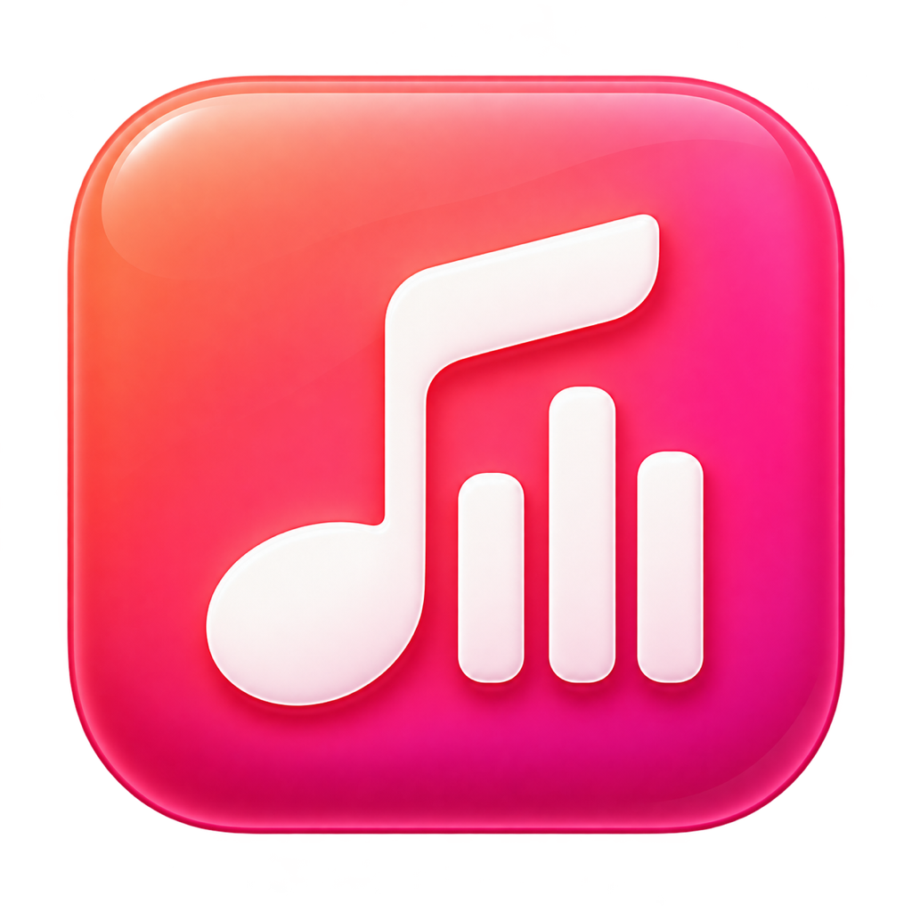

<p align="center">
  
</p>

# MusicBar

轻巧的 macOS 菜单栏音乐控件，直接控制 Apple Music。

菜单栏显示当前歌名，点击展开紧凑面板。上一首、播放/暂停、下一首位于歌名右侧，下方显示歌手及播放进度。正常状态只保留“打开音乐”和“退出控件”，连接出错时才显示错误提示与“重试”。

## 下载与使用

从 [Releases](https://github.com/blueroy00/MusicBar/releases/latest) 下载 `MusicBar-1.1.0-arm64.zip`，解压后将 `MusicBar.app` 放入“应用程序”，双击启动。

- 当前预编译版本适用于 **Apple Silicon Mac**。
- 编译目标为 macOS 13 及以上；目前仅在开发机器的 macOS 27.2 上实测，旧版本兼容性尚未实机验证。
- 首次使用需要允许 MusicBar 控制“音乐”。如曾拒绝，在“系统设置 → 隐私与安全性 → 自动化”中允许，回到控件点击“重试”。
- 应用使用本地临时签名，尚未经过 Apple 开发者签名和公证。下载版可能被 Gatekeeper 拦截；可选择阅读源码并在本机构建。
- 退出 MusicBar 不会停止音乐播放。不会自动添加登录启动项。

## 功能

- 菜单栏歌名与播放状态。
- 300 × 176 pt 紧凑面板，长歌名省略显示，悬停可查看完整标题。
- 上一首、播放/暂停、下一首。
- 歌手、当前时间、歌曲时长、播放进度。
- 出错时提供重试和授权说明。
- 任意应用开始使用麦克风或其他音频输入时自动暂停，可在面板右上角关闭。
- 原生 Swift / AppKit，无第三方运行依赖。

MusicBar 通过 Music 自带的 AppleScript 接口通信，不修改系统 Music.app，不注入进程，不读取账号凭据，也不向外部服务器发送数据。本项目是独立的伴随工具，与 Apple 无关联。

## 会议 / 录音时自动暂停

“自动暂停”默认开启，需要 macOS 14.2 或以上。不绑定飞书或其他会议软件：任意应用开始使用音频输入设备时，通常在两秒内暂停正在播放的 Apple Music。录音、语音通话、音频输入预览也会触发；只是打开会议软件不会触发。

检测使用 Core Audio 的进程输入状态和输入设备列表，只读状态，不录制声音，也不需要给 MusicBar 麦克风或屏幕录制权限。仅采集系统播放声音、没有输入设备的进程不会触发。

每个音频输入进程开始使用输入设备时只暂停一次；已有应用占用麦克风时，另一个应用开始使用输入仍会触发。之后手动恢复播放会被保留；音频输入结束后不会自动播放。面板会显示“麦克风使用中”，也可取消勾选“自动暂停”；设置会被记住。

这是基于音频输入占用的通用判断，不能直接识别会议。如果静音入会时会议软件完全不打开音频输入，MusicBar 无法检测到该会议。macOS 13–14.1 上其他播放功能照常可用，自动暂停不可用。

## 本机构建

安装 Xcode Command Line Tools，然后执行：

```sh
git clone https://github.com/blueroy00/MusicBar.git
cd MusicBar
zsh build.sh
open MusicBar.app
```

构建脚本使用当前 Mac 的 CPU 架构，输出 `MusicBar.app`，复制图标并完成本地临时签名，最后运行 21 项自检。无需 Xcode 项目或包管理器。

## 目录

```text
Source/main.swift     界面、Music 通信及基础自检
Source/AudioInputMonitor.swift  音频输入检测与自动暂停规则
Source/Info.plist     应用信息和自动化权限说明
Assets/AppIcon.png   图标原图
Assets/AppIcon.icns  macOS 应用图标
Assets/Design.md     图标设计记录
build.sh             构建、签名及自检
```

## 验证与已知边界

已验证编译、基础自检、真实歌曲信息读取、播放/暂停和恢复播放、上一首在歌曲中途返回开头，以及紧凑面板的实际显示。

自动暂停已通过 13 项规则自检（含多个输入进程同时使用麦克风），并使用 QuickTime 音频预览实测：输入开始触发暂停，手动恢复后不会反复暂停，关闭开关时保持播放，开关在重启后保留，输入结束不会自动续播。也核实了只有系统声音采集、没有音频输入设备时不会触发。验证过程中没有开始录音或保存声音。

状态约每两秒更新，进度条仅供显示。尚未完成下一首、拒绝授权、连接故障、Intel 和各旧版 macOS 的完整实机回归。
